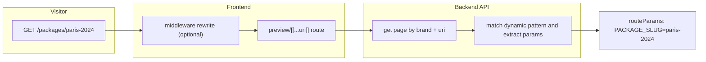

# Dynamic URL pages

This document describes dynamic URL pages: CMS pages whose path pattern includes variable segments (for example `/packages/<PACKAGE_SLUG>`). At request time, the visitor URL is matched to that pattern, values are extracted as route parameters, and those values can drive page-level APIs and widget data bindings.

For widget authoring basics, see [Widget System Overview](WidgetSystemOverview.md) and [Widget Development Guide V2](WidgetDevelopmentGuideV2.md).

---

## Quick start

Use this if you want a detail page like `/packages/<PACKAGE_SLUG>`:

1. Create a dynamic page in [frontend/components/builder/CreatePageDialog.tsx](../frontend/components/builder/CreatePageDialog.tsx) with URI `/packages/<PACKAGE_SLUG>`.
2. In Page Data ([frontend/components/builder/PageDataPanel.tsx](../frontend/components/builder/PageDataPanel.tsx)), create an API call that uses the URL variable.
3. Bind widget config fields to API results and/or variables in the builder.
4. Preview with test values in Page Data, then publish.
5. Open a concrete URL such as `/packages/paris-2024`.

---

## Concepts

| Term | Meaning |
|------|---------|
| **Pattern (URI)** | Stored page path template, e.g. `/packages/<PACKAGE_SLUG>`. |
| **Dynamic variables** | Names inside `<...>` (UI convention), stored without brackets in `Page.DynamicVariables`, e.g. `PACKAGE_SLUG`. |
| **Route params** | Key/value map produced by matching an incoming URL, e.g. `{ "PACKAGE_SLUG": "paris-2024" }`. |
| **Static vs dynamic** | A static page has one fixed path (`/about`). A dynamic page matches many URLs with shared literal segments. |

You do not create a separate "dynamic widget type." You use normal widgets with configuration and bindings that reference URL-driven values.

---

## Author workflow

### 1. Create the page

1. In the builder, choose New Page -> Dynamic URL (or enter a URI with `<VARIABLE>` segments).
2. Use SCREAMING_SNAKE_CASE variable names inside angle brackets only: `<PACKAGE_SLUG>`, `<COUNTRY>`.
3. On create, the client sends `uri`, `isDynamic`, and `dynamicVariables`, so metadata is persisted on first save.

Relevant code: [frontend/components/builder/CreatePageDialog.tsx](../frontend/components/builder/CreatePageDialog.tsx), [frontend/services/api/pagesApi.ts](../frontend/services/api/pagesApi.ts)

### 2. Configure page data

1. Open Page Data in [frontend/components/builder/PageDataPanel.tsx](../frontend/components/builder/PageDataPanel.tsx).
2. Define API calls that use URL variables in path/query/body.
3. Enter builder-only test values for URL variables when previewing.

### 3. Bind widgets

1. Add widgets as usual.
2. Bind widget props to API results and/or route variables.
3. Example binding usage (conceptual):
   - API endpoint template: `/api/packages/{{PACKAGE_SLUG}}`
   - Widget title binding: `{{package.name}}`

   Alternatively, use **Auto-pass URL params** (see below) so you don't need to template the endpoint manually.

### 4. Publish and verify

1. In [frontend/components/builder/PublishDialog.tsx](../frontend/components/builder/PublishDialog.tsx), use the Dynamic URL preview inputs (one per variable).
2. Publish and test with concrete URLs.

### 5. Optional listing/detail pairing

Common pattern:

- Listing page (static): `/packages`
- Detail page (dynamic): `/packages/<PACKAGE_SLUG>`

Listing widgets should link to concrete detail URLs (for example, `/packages/${slug}`).

---

## Auto-pass dynamic URL params to widget API

Widgets that have an `apiEndpoint` field support an opt-in toggle that automatically appends the page's dynamic URL variables as query params before each fetch. This removes the need to template the endpoint manually.

### How to enable

1. Select a widget on a dynamic page in the builder.
2. Open the **Content** tab in the Properties panel.
3. When the page has dynamic variables and an API endpoint is configured, a **Pass URL params to API** toggle appears below the endpoint fields.
4. Turn the toggle ON.
5. Optionally enter a **query key rename** for each variable (e.g. map `SUMMER` -> `season`). Leave blank to use the original name.

### What happens at runtime

For a page `/holidays/<SUMMER>` visited as `/holidays/summer` with toggle ON and no mapping:

```
widget apiEndpoint: http://localhost:6001/api/public/holidays
actual fetch:       http://localhost:6001/api/public/holidays?SUMMER=summer
```

With a mapping `SUMMER -> season`:

```
actual fetch: http://localhost:6001/api/public/holidays?season=summer
```

### Rules

- Existing query params already on the endpoint are never overwritten.
- Reserved pagination keys `page` and `pageSize` are skipped even if mapped to them.
- Empty values are skipped.
- Keys and values are URL-encoded.
- Default is OFF; existing widgets without the toggle are unaffected.
- Works on both server-side (SSR initial render) and client-side (load more, re-render) fetch paths.

### Relevant code

- Helper: [frontend/lib/widgetRouteParams.ts](../frontend/lib/widgetRouteParams.ts)
- SSR path: [frontend/lib/widgetEndpointSsr.ts](../frontend/lib/widgetEndpointSsr.ts), [frontend/lib/embed/resolvePublishedWidgetConfig.ts](../frontend/lib/embed/resolvePublishedWidgetConfig.ts)
- Builder UI: [frontend/components/builder/properties/PropertiesContentTab.tsx](../frontend/components/builder/properties/PropertiesContentTab.tsx)
- Widget implementations can opt in through their `apiEndpoint` configuration and pass the resolved URL variables to the shared fetch helpers.

---

## How a request becomes route params



1. Middleware may rewrite custom domains in [frontend/middleware.ts](../frontend/middleware.ts).
2. The preview route loads the page in [frontend/app/preview/[brandKey]/[[...uri]]/page.tsx](../frontend/app/preview/[brandKey]/[[...uri]]/page.tsx).
3. API resolution in [backend/src/Cms.Application/Services/Pages/PageService.cs](../backend/src/Cms.Application/Services/Pages/PageService.cs):
   - exact URI match first
   - if missed, dynamic published match via [backend/src/Cms.Persistence/Repositories/PageRepository.cs](../backend/src/Cms.Persistence/Repositories/PageRepository.cs)

If no page matches, the frontend route returns 404.

---

## Pattern syntax (backend matcher)

The matcher supports:

- Literal segments: `about`
- Angle-bracket params: `<PACKAGE_SLUG>` (CMS authoring format)
- Colon params: `:slug` (supported by matcher for compatibility)
- Trailing wildcard: `*`

Note: authors should use angle-bracket syntax in CMS UI. Colon syntax is backend-compatible but not the primary authoring format.

Pattern behavior is covered by [backend/tests/Cms.Api.Tests/Repositories/PageRepositoryDynamicUriTests.cs](../backend/tests/Cms.Api.Tests/Repositories/PageRepositoryDynamicUriTests.cs).

---

## Route param flow to widgets (frontend)

- Main body widgets receive route params through [frontend/components/viewer/PublishedPageRenderer.tsx](../frontend/components/viewer/PublishedPageRenderer.tsx).
- Header/footer layout widgets also receive route params via [frontend/components/viewer/SiteLayoutWrapper.tsx](../frontend/components/viewer/SiteLayoutWrapper.tsx).

This allows data bindings in all surfaces (body, header, footer) to use URL-derived values.

---

## Builder vs published behavior

| Concern | Builder (authenticated) | Published / preview (public client) |
|--------|-------------------------|-------------------------------------|
| Route param test values | May be stored in `localStorage` for author preview in Page Data. | Must not rely on builder `localStorage`. Public `getPageData` calls skip this merge. |
| Source of variable values | Page Data test inputs + current editing context. | Actual URL -> API route params. |

This prevents stale author test values from leaking into public rendering.

Relevant code: [frontend/services/api/pageDataApi.ts](../frontend/services/api/pageDataApi.ts), [frontend/services/mappers/pageMapper.ts](../frontend/services/mappers/pageMapper.ts)

---

## Validation, integrity, and performance

- URI validation is centralized in [frontend/lib/pageUriValidation.ts](../frontend/lib/pageUriValidation.ts) and used by create/edit dialogs.
- Dynamic variable names use `<NAME>` with `A-Z` and underscores.
- `DynamicVariables` are stored without brackets.
- URI uniqueness is enforced in service logic (create/update checks) and by DB unique index on `(BrandId, Uri)` in [backend/src/Cms.Persistence/Configurations/PageConfiguration.cs](../backend/src/Cms.Persistence/Configurations/PageConfiguration.cs).
- Dynamic candidate lists are memory-cached per brand for published route matching, with cache invalidation on writes.

Relevant code: [backend/src/Cms.Application/Services/Pages/PageService.cs](../backend/src/Cms.Application/Services/Pages/PageService.cs), [backend/src/Cms.Persistence/Repositories/PageRepository.cs](../backend/src/Cms.Persistence/Repositories/PageRepository.cs)

---

## Published-only considerations

- Dynamic URI matching path in the repository resolves published pages.
- Draft behavior in editor/preview flows may differ based on the route and API path used.
- Sitemap generation generally targets published static pages, so dynamic patterns are not emitted as concrete URLs.

---

## Testing

- Matcher coverage: [backend/tests/Cms.Api.Tests/Repositories/PageRepositoryDynamicUriTests.cs](../backend/tests/Cms.Api.Tests/Repositories/PageRepositoryDynamicUriTests.cs)
  - angle-bracket and colon params
  - wildcard behavior
  - specificity ordering
  - draft exclusion
  - brand isolation

---

## Related docs

- [Widget System Overview](WidgetSystemOverview.md)
- [Widget Development Guide V2](WidgetDevelopmentGuideV2.md)
- [High-Level Design](HighLevelDesign.md)
