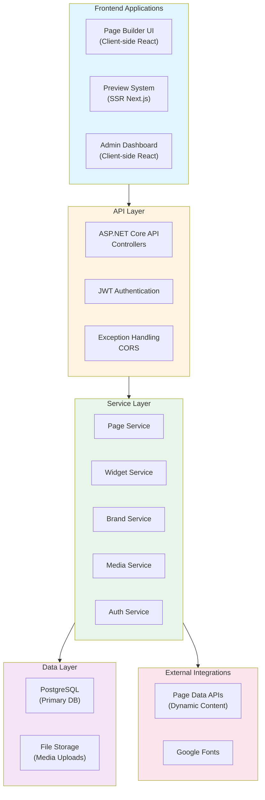
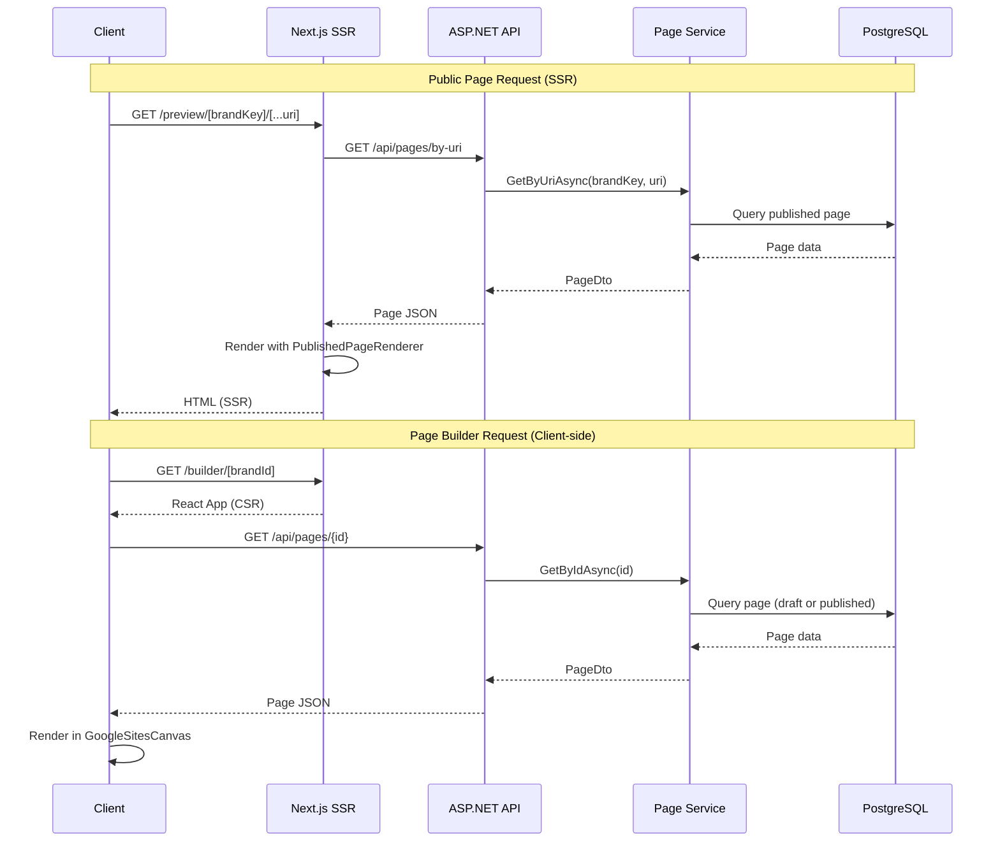
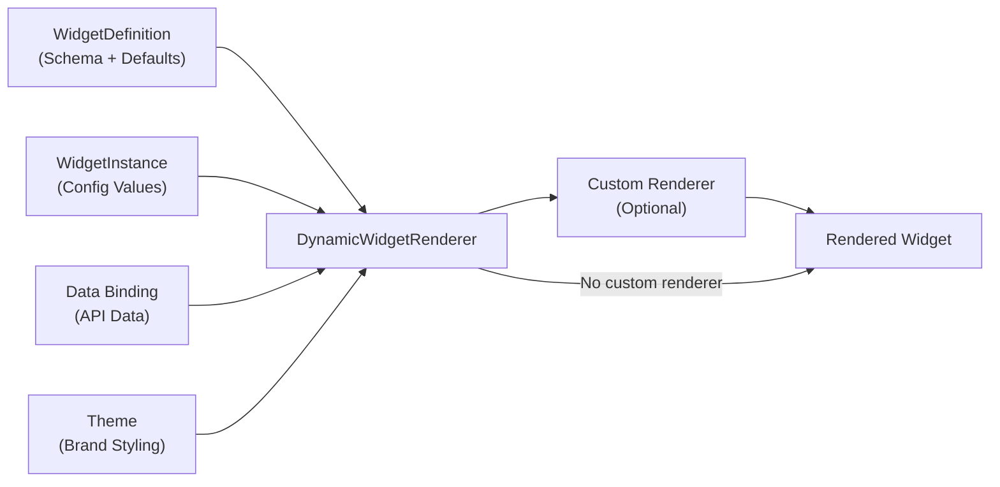

# CMS - High-Level Design Document

## 1. Objective

CMS is a multi-tenant content management system and page builder designed to enable multiple travel brands under Cms (an OTA) to manage their online presence independently. The system separates concerns between Engineers (who create widgets) and Content Teams (who build pages), with Admin oversight for user and brand management.

**Key Objectives:**
- Enable Content Teams to create and manage pages without engineering intervention
- Provide widget-based architecture for reusable, brand-agnostic components
- Support multi-tenancy with brand-specific theming and permissions
- Ensure scalability for handling large numbers of pages and routes
- Maintain separation of concerns between widget development and content management
- Support dynamic routing with pattern matching (`:param`, `*` wildcards)
- Enable server-side rendering (SSR) for public pages for SEO optimization
- Provide draft/published revision system for safe content publishing

## 2. System Architecture Overview

### 2.1 High-Level Architecture

CMS follows a multi-layered architecture with clear separation between:
- **Frontend Layer**: Next.js 14 App Router with SSR for public pages, client-side React app for Page Builder
- **API Layer**: ASP.NET Core 10 RESTful APIs for CRUD operations, authentication, and data management
- **Service Layer**: Business logic for pages, widgets, templates, routing, media, and SEO
- **Data Layer**: PostgreSQL database for persistent storage, file storage for media assets
- **Widget System**: Folder-based widgets under `widgets/widget-{slug}/` or optionally `widgets/{brand}/widget-{slug}/` (with `v1/`, `v2/` version folders); definitions auto-discovered from C# `IWidgetVersionProvider`/`IWidgetDefinitionProvider`, renderers auto-discovered at frontend build time; optional SSR for published pages via `ssrEndpoints.ts`

### 2.2 Architecture Diagram



### 2.3 Page Rendering Flow

The system uses two distinct rendering paths:

1. **Public Pages (SSR)**: Server-side rendered via Next.js for SEO optimization
2. **Page Builder (Client-side)**: React application for content editing



### 2.4 Widget Rendering Pipeline



## 3. Core Components

### 3.1 Page Builder

**Purpose**: Visual drag-and-drop interface for Content Teams to create and edit pages.

**Key Features:**
- Drag-and-drop widget placement with sortable sections
- Real-time preview in builder canvas
- Widget configuration panels with JSON Schema validation
- Page Data management (API calls, variables, data bindings)
- Template application
- Responsive design preview (mobile, tablet, desktop)
- Section-based layout system (1-col, 2-col, 3-col, 4-col, sidebar layouts)
- Column span configuration per breakpoint
- Visibility rules for widgets
- Action handlers (navigate, scroll, trigger API, open modal)
- Undo/redo functionality
- SEO panel for page-level optimization
- Custom CSS per page
- Page revision management (draft/published)

**Location**: `frontend/components/builder/`

**Key Components:**
- `GoogleSitesCanvas.tsx`: Main editing canvas (`/builder/[brandId]`)
- `GoogleSitesHeader.tsx`: Builder chrome (toolbar, preview, etc.)
- `widget-library-panel/WidgetLibraryPanel.tsx`: Resizable side panel (Insert widget catalog, Pages, Themes)
- `PropertiesPanel.tsx`: Widget configuration UI
- `DataBindingEditor.tsx`: API data binding configuration
- `PageSeoPanel.tsx`: SEO metadata editor
- `DynamicWidgetRenderer.tsx`: Widget rendering orchestrator

### 3.2 Widget System

**Purpose**: Reusable, configurable components that can be placed on pages.

**Architecture**: Two-part pattern
- **WidgetDefinition**: Schema created by engineers (stored in database)
- **WidgetInstance**: Runtime data when widget is placed on a page

**Key Features:**
- JSON Schema-based configuration
- Default config and styles
- Custom renderers for complex widgets
- Data binding support (API responses, variables)
- Theme integration (CSS variables)
- Brand availability controls
- Advanced widget flag (requires admin authorization)
- Category-based organization (Layout, Content, Media, Interactive, Navigation)

**Widget Definition Schema:**
```typescript
{
  id: Guid
  slug: string              // Used for custom renderer lookup
  name: string
  category: WidgetCategory
  description: string
  icon: string              // Lucide icon name
  version: string
  configSchema: JSON        // JSON Schema for validation
  defaultConfig: JSON
  defaultStyles: WidgetStyles
  brandIds: Guid[]          // Empty = available to all
  isAdvanced: boolean
}
```

**Widget Instance Schema:**
```typescript
{
  id: Guid
  widgetDefinitionId: Guid
  config: Record<string, unknown>  // User-configured values
  styles: WidgetStyles
  dataBindings: DataBinding[]
  actions: Action[]
  visibilityRules?: VisibilityRule[]
}
```

**Location**: 
- Backend: widget definitions/versions discovered from `widgets/**/*.cs` (e.g. `Definition.cs` implementing `IWidgetVersionProvider`); entities in `backend/src/Cms.Domain/Entities/WidgetDefinition.cs`
- Frontend: renderers loaded from repo-level `widgets/` via `frontend/components/builder/customRenderers/index.ts` (require.context); optional SSR mapping in `frontend/lib/widgetEndpointSsr.ts` (built from `widgets/**/ssrEndpoints.ts`)

**Published-page SSR vs external HTML embed**

These solve different problems:

- **Published-page SSR** (`ssrEndpoints.ts` per widget version + `frontend/lib/widgetEndpointSsr.ts`): When the CMS Next.js app renders a preview or published page, the server can pre-fill API-backed widget data so the first HTML already contains that content. This is in-app only.

- **External HTML embed** (`GET /api/embed/widget` on the Next.js app): Returns a server-rendered **HTML fragment** for a single widget instance on a page **body** so an external host can `fetch` and inline it (SEO, no iframe). Widget definitions expose `supportsHtmlEmbed` when the version provider sets `SupportsHtmlEmbed`; the route also requires a matching template in `frontend/lib/embed/embedRenderers.tsx`. Optional `EMBED_API_SECRET` restricts access. Operational detail, auth, status codes, and builder UX: [widget-html-embed.md](widget-html-embed.md).

### 3.3 Routing System

**Purpose**: Dynamic routing for pages created by Content Teams.

**Key Features:**
- URL-to-Page mapping with brand context
- Static and dynamic URL support:
  - Static: `/about`, `/contact`
  - Dynamic with params: `/blog/:slug`, `/trips/:destination`
  - Wildcard: `/docs/*` (matches `/docs/anything/here`)
- Duplicate detection and warnings
- Redirect management
- Domain/subdomain handling via brand configuration
- High-performance routing for large page counts

**Technical Approach:**
- Database-backed routing table (Page.Uri)
- Pattern matching algorithm with specificity scoring
- Route parameter extraction
- Exact match first, then dynamic pattern matching
- Normalized URI comparison (case-insensitive, trailing slash handling)

**Location**: `backend/src/Cms.Persistence/Repositories/PageRepository.cs`

**Pattern Matching:**
- `:param` - Named parameter (e.g., `/blog/:slug` matches `/blog/my-post`)
- `*` - Wildcard (matches remaining segments)
- Specificity: More literal segments = higher priority

### 3.4 Theme System

**Purpose**: Brand-specific styling and visual identity.

**Key Features:**
- Color palette (primary, secondary, background, text, accent)
- Font configuration (heading, body)
- Google Fonts integration
- Custom font URLs per brand
- CSS variable injection
- Theme inheritance and defaults
- Brand-level global CSS

**Theme Structure:**
```typescript
{
  id: Guid
  name: string
  colors: {
    primary: string
    secondary: string
    background: string
    text: string
    accent: string
  }
  fonts: {
    heading: string
    body: string
  }
  headingFontConfig?: FontConfig
  bodyFontConfig?: FontConfig
  isDefault: boolean
  brandId?: Guid
}
```

**Location**: `backend/src/Cms.Domain/Entities/Theme.cs`

### 3.5 Site Layout System

**Purpose**: Global header and footer management shared across pages.

**Key Features:**
- Header widget composition
- Footer widget composition
- Optional sidebar
- Brand-specific layouts
- Page-level layout assignment

**Structure:**
```typescript
{
  id: Guid
  brandId: Guid
  name: string
  header: WidgetInstance[]    // JSON stored as string
  footer: WidgetInstance[]    // JSON stored as string
  sidebar?: WidgetInstance[]  // JSON stored as string
}
```

**Location**: `backend/src/Cms.Domain/Entities/SiteLayout.cs`

### 3.6 Page Revision System

**Purpose**: Draft/published separation for safe content publishing.

**Key Features:**
- Draft revision (work-in-progress)
- Published revision (live version)
- Version tracking
- Safe publishing workflow
- Rollback capability

**Structure:**
- `Page` entity tracks `draftRevisionId` and `publishedRevisionId`
- `PageRevision` stores complete page snapshot (layout, SEO, theme, CSS)
- Publishing promotes draft to published

**Location**: 
- `backend/src/Cms.Domain/Entities/Page.cs`
- `backend/src/Cms.Domain/Entities/PageRevision.cs`

### 3.7 Page Data System

**Purpose**: Dynamic content integration via API calls.

**Key Features:**
- Page-level variables (URL params, static values)
- API call configuration (GET/POST, headers, body)
- Data binding to widget properties
- Transformation functions (format_date, format_currency, etc.)
- Default/fallback values
- Expression evaluation

**Structure:**
```typescript
{
  pageId: Guid
  variables: PageVariable[]     // URL params, static vars
  apiCalls: ApiCall[]          // External API configurations
}
```

**Data Binding:**
- Links widget properties to API response paths
- Supports dot notation (e.g., `data.attributes.hotel_name`)
- Transformation pipeline for data formatting

**Location**: 
- `backend/src/Cms.Domain/Entities/PageDataConfig.cs`
- `frontend/lib/dataBinding.ts`

### 3.8 Media Library

**Purpose**: Centralized media asset management.

**Key Features:**
- Upload/download capabilities
- Brand-specific media storage
- Folder organization
- Image thumbnails
- File type validation
- Size tracking
- Alt text support

**Location**: `backend/src/Cms.Domain/Entities/MediaItem.cs`

### 3.9 Template System

**Purpose**: Reusable page compositions for faster content creation.

**Key Features:**
- Template CRUD operations
- Widget composition storage
- Template application to new pages
- Brand-specific or global templates
- Template categories
- Thumbnail previews

**Location**: `backend/src/Cms.Domain/Entities/Template.cs`

### 3.10 SEO & Content Quality

**Purpose**: SEO optimization and content quality management.

**Key Features:**
- Page-level SEO fields:
  - Title, description, keywords
  - Open Graph tags (ogTitle, ogDescription, ogImage)
  - Twitter Cards (twitterTitle, twitterDescription, twitterImage)
  - Canonical URL
  - No-index/no-follow flags
- Site-level SEO:
  - robots.txt configuration
  - Site name, description
  - Default OG image
- Server-side metadata generation for SSR
- Structured data support (future)

**Location**: 
- `backend/src/Cms.Domain/ValueObjects/PageSeo.cs`
- `backend/src/Cms.Domain/Entities/SiteSettings.cs`

### 3.11 Authentication & Authorization

**Purpose**: User management and access control.

**Key Features:**
- JWT-based authentication
- Role-based access control (RBAC):
  - **Admin**: User management, brand assignment, widget authorization
  - **ContentTeam**: Page/Template CRUD, widget usage
  - **Engineer**: Widget creation and deployment
- Brand-level permissions
- Current user context service
- Session management

**Location**: 
- `backend/src/Cms.Application/Services/Auth/AuthService.cs`
- `backend/src/Cms.Application/Services/Infrastructure/JwtService.cs`

### 3.12 Audit Logging

**Purpose**: Track all user actions for compliance and debugging.

**Key Features:**
- Comprehensive audit logging
- User action tracking
- Entity change tracking
- JSON details storage
- Timestamp and user attribution

**Location**: `backend/src/Cms.Domain/Entities/AuditLog.cs`

## 4. API Design

### 4.1 Authentication APIs

```
POST   /api/auth/login          # Login (email + password)
POST   /api/auth/register       # User registration
GET    /api/auth/me             # Current user info
```

### 4.2 Brand APIs

```
GET    /api/brands              # List brands (filtered by user)
GET    /api/brands/{id}         # Get brand by ID or subdomain
POST   /api/brands              # Create brand (Admin only)
PUT    /api/brands/{id}         # Update brand
DELETE /api/brands/{id}         # Delete brand
```

### 4.3 Page APIs

```
GET    /api/pages               # List pages (filter by brandId)
GET    /api/pages/{id}          # Get page details
GET    /api/pages/by-uri        # Get page by URI (public endpoint)
POST   /api/pages               # Create page
PUT    /api/pages/{id}          # Update page
DELETE /api/pages/{id}          # Delete page
POST   /api/pages/{id}/publish  # Publish page (promote draft to published)
POST   /api/pages/{id}/unpublish # Unpublish page
POST   /api/pages/{id}/validate-uri # Validate URI uniqueness
```

### 4.4 Widget APIs

```
GET    /api/widgets             # List available widgets (filtered by brand/user)
GET    /api/widgets/{id}        # Get widget details
GET    /api/widgets/categories  # List widget categories
```

### 4.5 Theme APIs

```
GET    /api/themes              # List themes (filter by brandId)
GET    /api/themes/{id}         # Get theme details
POST   /api/themes              # Create theme
PUT    /api/themes/{id}         # Update theme
DELETE /api/themes/{id}         # Delete theme
```

### 4.6 Site Layout APIs

```
GET    /api/site-layouts        # List site layouts (filter by brandId)
GET    /api/site-layouts/{id}   # Get site layout details
POST   /api/site-layouts        # Create site layout
PUT    /api/site-layouts/{id}   # Update site layout
DELETE /api/site-layouts/{id}   # Delete site layout
```

### 4.7 Site Settings APIs

```
GET    /api/site-settings       # Get site settings (filter by brandId)
PUT    /api/site-settings       # Update site settings
```

### 4.8 Template APIs

```
GET    /api/templates           # List templates (filter by brandId)
GET    /api/templates/{id}      # Get template details
POST   /api/templates           # Create template
PUT    /api/templates/{id}       # Update template
DELETE /api/templates/{id}      # Delete template
```

### 4.9 Media APIs

```
GET    /api/media               # List media (filter by brandId)
POST   /api/media               # Upload media
GET    /api/media/{id}         # Get media details
DELETE /api/media/{id}         # Delete media
```

### 4.10 Page Data APIs

```
GET    /api/page-data/{pageId} # Get page data configuration
POST   /api/page-data           # Create/update page data configuration
```

### 4.11 System APIs

```
GET    /api/system/config       # Get system configuration (spacing, shadows, widget categories)
```

### 4.12 Audit Log APIs

```
GET    /api/audit-logs          # Get audit logs (filtered by user, entity, date range)
```

### 4.13 Proxy APIs

```
POST   /api/proxy               # Proxy API calls for Page Data (CORS handling)
```

## 5. Security Design

### 5.1 Authentication & Authorization

**Current Implementation:**
- JWT-based authentication
- Role-based access control (RBAC):
  - Admin: Full system access
  - ContentTeam: Page/Template management
  - Engineer: Widget development access
- Brand-level permission checks
- Widget-level permission checks (Advanced widgets require admin authorization)

**JWT Configuration:**
- Symmetric key signing
- Configurable issuer and audience
- Token lifetime validation
- Refresh token support (future)

**Location**: `backend/src/Cms.Api/Program.cs`

### 5.2 Data Security

- Input validation via FluentValidation
- SQL injection prevention (EF Core parameterized queries)
- XSS prevention (content sanitization in frontend)
- CORS configuration for frontend origin
- Secure file upload validation
- Media URL validation

### 5.3 Widget Security

- Configuration validation against JSON Schema
- Safe expression evaluation for data transformations
- No inline scripts/styles in widget definitions (enforced)
- CSP headers (future enhancement)
- Widget sandboxing (future enhancement)

### 5.4 Audit & Compliance

- Comprehensive audit logging for all entity changes
- User action tracking
- JSON details storage for change tracking
- Timestamp and user attribution
- GDPR/CCPA compliance considerations (future)

## 6. Scalability & Performance

### 6.1 Database Optimization

- Indexed routing table for fast URL resolution
- Pagination for large result sets
- Database connection pooling (EF Core)
- Query optimization with `AsNoTracking()` for read operations
- Eager loading for related entities where needed

### 6.2 Caching Strategy

**Current Implementation:**
- Frontend caching via TanStack Query
- Widget definitions cached in frontend
- No backend caching yet (future: Redis)

**Future Enhancements:**
- Redis Cache for:
  - Route resolution cache
  - Widget bundle cache
  - Page metadata cache
  - User session cache
  - Brand theme cache
- CDN for:
  - Static widget assets
  - Media library files
  - Published page HTML/CSS/JS

### 6.3 Performance Targets

- Page load time: < 2 seconds (first contentful paint)
- Route resolution: < 50ms
- Widget library load: < 1 second
- API response time: < 200ms (p95)
- SSR render time: < 500ms

### 6.4 Scalability Considerations

- Horizontal scaling for API servers (stateless design)
- Database read replicas for read-heavy operations (future)
- Distributed caching (future: Redis cluster)
- Load balancing (future)
- Auto-scaling based on traffic (future)

## 7. Widget Development Workflow

### 7.1 Widget Creation Process

1. **Engineer creates a widget** (no manual seeder or registry edits):
   - Run `node tools/widget-create.js my-widget` (or from `frontend/`: `npm run widget:create my-widget`) to scaffold `widgets/widget-my-widget/` with `Definition.cs` and `index.tsx`.
   - For versioned widgets, use subfolders `widgets/widget-{slug}/v1/`, `v2/`, etc. (or `widgets/{brand}/widget-{slug}/v1/`, … when grouped by brand); each has its own `Definition.cs` (implementing `IWidgetVersionProvider`) and `index.tsx`.
   - Define manifest, configuration schema, and React renderer in the widget folder. Backend discovers definitions via reflection; frontend discovers renderers at build time via `customRenderers/index.ts` (require.context on `widgets/`).

2. **Widget registration**: Discovered definitions are upserted by the database seeder into `widget_definitions` and `widget_definition_versions`. Widget appears in Widget Library; brand availability is configured in the definition.

3. **Content Team usage**: Widget appears in Widget Library, can be dragged onto pages, configured via schema-defined UI, and published.

**Details**: See [widgets/README.md](../widgets/README.md) and [WidgetDevelopmentGuideV2.md](WidgetDevelopmentGuideV2.md).

### 7.2 Widget Versioning Strategy

- Versioned widgets use folder structure `widgets/widget-{slug}/v1/`, `v2/`, etc., or `widgets/{brand}/widget-{slug}/v1/`, … Each version has its own schema, defaults, and renderer.
- Semantic versioning (major.minor.patch) is used; the system resolves the latest version for the library. Backward compatibility is maintained by keeping older versions available.

### 7.3 Custom Renderer and Optional SSR

- **Renderers**: React components live in `widgets/widget-{slug}/index.tsx` or `widgets/widget-{slug}/v{n}/index.tsx`, or under `widgets/{brand}/widget-{slug}/v{n}/index.tsx`. They are auto-discovered; no registration in `customRenderers/index.ts` is needed when adding a new widget (the index uses require.context over the `widgets/` tree).
- **SSR for published pages**: Widgets that fetch from a configurable API can add `ssrEndpoints.ts` in the version folder so the published page pre-fills that data on first paint. See [widgets/README.md — Server-side data (SSR)](../widgets/README.md#server-side-data-ssr-for-published-pages).

## 8. Deployment Architecture

### 8.1 Environment Strategy

- **Development**: Local development environment
- **Staging**: Pre-production testing (future)
- **Production**: Live environment for all brands

### 8.2 Technology Stack

**Frontend:**
- Next.js 14 App Router
- React 18
- TypeScript
- Tailwind CSS
- TanStack Query
- Node.js 18+

**Backend:**
- ASP.NET Core 10
- Entity Framework Core
- PostgreSQL 15+
- JWT Authentication
- FluentValidation
- Swashbuckle (Swagger)

**Orchestration:**
- .NET Aspire (optional)

### 8.3 Infrastructure Components

- **Application Servers**: Containerized (Docker) - future
- **Database**: PostgreSQL with replication - future
- **Cache**: Redis cluster - future
- **CDN**: CloudFront/Cloudflare for static assets - future
- **Load Balancer**: Application load balancer - future

### 8.4 CI/CD Pipeline

**Current**: Manual deployment
**Future**:
- Code Commit → Automated Tests → Build → Deploy to Staging → Manual Approval → Deploy to Production
- Widget Deployment: Automated testing required before publishing

## 9. Integration Points

### 9.1 External APIs

**Page Data APIs:**
- Content Teams can configure API calls for dynamic content
- CORS proxy endpoint for external API access
- Support for GET and POST requests
- Header and body configuration
- Response transformation

**Location**: `backend/src/Cms.Api/Controllers/ProxyController.cs`

### 9.2 Google Fonts Integration

- Automatic font URL generation
- Theme-based font selection
- Custom font URL support per brand

**Location**: `frontend/lib/fontLoader.ts`

### 9.3 Future Integrations

- SSO Integration: Enterprise identity provider (v1.1+)
- Analytics Integration: Widget-level analytics tracking
- Media Optimization Services: Image processing and optimization
- SEO Validation Services: Structured data validation
- CDN Integration: Static asset delivery

## 10. Error Handling & Resilience

### 10.1 Error Handling Strategy

**Backend:**
- Global exception handler middleware
- Structured error responses
- HTTP status code mapping
- Error logging

**Location**: `backend/src/Cms.Api/Middleware/GlobalExceptionHandlerMiddleware.cs`

**Frontend:**
- Error boundaries for React components
- Graceful degradation for widget failures
- Fallback UI for broken widgets
- User-friendly error messages

### 10.2 Monitoring & Alerting

**Current**: Console logging
**Future**:
- Application performance monitoring (APM)
- Error tracking and alerting
- Widget performance metrics
- Page load time monitoring
- Database performance monitoring
- Cache hit/miss ratios

## 11. Data Migration & Backup

### 11.1 Backup Strategy

**Current**: Manual backups
**Future**:
- Daily database backups
- Point-in-time recovery capability
- Media asset backups
- Configuration backups

### 11.2 Migration Considerations

- EF Core migrations for schema changes
- Widget version migration paths (future)
- Template migration when widgets deprecated
- Brand data migration
- User data migration

**Location**: `backend/src/Cms.Persistence/Migrations/`

## 12. Testing Strategy

### 12.1 Widget Testing

**Current**: Backend and frontend test projects run in CI (`dotnet test`, `npm run build` / lint); widget **rendering** in the builder and preview is still often validated manually.

**Future**:
- Deeper unit tests per widget and config validation
- Integration tests for widget rendering and interactions
- Storybook: Visual component testing
- E2E tests: Full widget lifecycle
- Regression suites for the widget catalog

### 12.2 System Testing

**Current**: Automated API and app builds in CI; full UX and cross-browser checks are still partly manual.

**Future**:
- API Testing: All endpoints with various scenarios
- Performance Testing: Load testing for routing and page rendering
- Security Testing: Penetration testing and vulnerability scanning
- Accessibility Testing: WCAG 2.1 Level AA compliance

**Test Frameworks:**
- Backend: xUnit + Moq
- Frontend: Vitest + React Testing Library

## 13. Future Enhancements

This section separates **what already ships** (so roadmap items are not confused with gaps) from **planned** and **exploratory** work.

### 13.1 Delivered capabilities (non-exhaustive)

- Multi-tenant **brands**, themes, site layout (header/footer), **page builder**, **draft/publish**, preview **SSR** (`app/preview/...`)
- **Folder-based widgets** with `WidgetDefinition` / `WidgetDefinitionVersion`, auto-discovery from `widgets/**/*.cs`, React renderers from `widgets/` at build time
- **Published-page data SSR** via optional `ssrEndpoints.ts` and `frontend/lib/widgetEndpointSsr.ts`
- **External HTML embed** for host apps: `GET /api/embed/widget` — see [widget-html-embed.md](widget-html-embed.md)
- **MOS Gateway** sign-in when configured (`app/signin/`, `(admin)/login/`, callback route)
- **Widget-level i18n** — see [I18n.md](I18n.md)
- **Docker** images and **Compose** stacks; **CI** via Jenkins and/or Bitbucket Pipelines (repo root)

### 13.2 Planned / roadmap (v1.1+)

- SSO enhancements beyond the current MOS Gateway flow (e.g. additional IdPs or enterprise options)
- Advanced collaboration features
- Real-time co-editing
- A/B testing framework
- Advanced analytics dashboard
- Rich **widget version history UI** and migration helpers (version **data** already exists; operator-facing history is not fully covered here)
- Redis caching
- CDN integration
- Automated backups

### 13.3 Potential enhancements

- AI-powered content suggestions
- Automated SEO optimization
- Performance optimization recommendations
- Content personalization
- Advanced widget gallery
- Full site/route-level i18n (e.g. locale in path, translated builder UI); widget-level i18n is already supported (see [I18n.md](I18n.md))
- Content scheduling
- Workflow approvals

## 14. Appendix

### 14.1 Technology Stack

**Frontend:**
- Next.js 14 App Router
- React 18 + TypeScript
- Tailwind CSS
- TanStack Query
- Vitest + React Testing Library

**Backend:**
- ASP.NET Core 10 (C# 14)
- Entity Framework Core
- PostgreSQL 15+
- FluentValidation
- Swashbuckle (OpenAPI)
- xUnit + Moq

**DevOps:**
- Docker and Docker Compose for local and deployment images (see repo `Dockerfile`, `docker-compose*.yaml`)
- CI: Bitbucket Pipelines (`bitbucket-pipelines.yml`) and/or Jenkins (`Jenkinsfile`)

### 14.2 Key Design Decisions

1. **Widget Versioning**: Multiple **major** versions per slug can coexist (`WidgetDefinitionVersion`, `widgets/.../v1/`, `v2/`, …). Instances keep working against their resolved version; the library surfaces the latest by default. Future work may add richer **version history UI** and migration tooling (see §13.2).

2. **Multi-tenancy**: Brand-level isolation with shared infrastructure. Each brand has its own pages, themes, layouts, and media.

3. **Separation of Concerns**: Engineers own widgets (definitions), Content Teams own pages (instances).

4. **Dynamic Routing**: Flexible URL system supporting both static and dynamic routes with pattern matching.

5. **Template System**: Reusable compositions to accelerate content creation.

6. **Draft/Published Pattern**: Page revisions enable safe content publishing with rollback capability.

7. **SSR for Public Pages**: Server-side rendering for SEO optimization while maintaining client-side builder.

8. **Audit Logging**: Comprehensive tracking for compliance and accountability.

9. **Page Data Integration**: External API integration for dynamic content without code changes.

10. **Theme System**: Brand-specific styling with CSS variables for consistent theming.

### 14.3 Project Structure

```
content-studio/
├── frontend/                  # Next.js frontend application
│   ├── app/                   # Next.js App Router
│   │   ├── (admin)/          # Admin routes (client-side)
│   │   │   ├── brands/
│   │   │   ├── builder/
│   │   │   ├── login/        # Login UI
│   │   │   ├── media/
│   │   │   └── users/
│   │   ├── api/embed/widget/ # SSR HTML fragment for external sites
│   │   ├── preview/          # Published page preview (SSR)
│   │   ├── signin/           # MOS / SSO entry (route handler)
│   │   ├── signin-callback/  # OAuth callback (route handler)
│   │   ├── dev/health/       # Liveness
│   │   └── layout.tsx
│   ├── components/           # React components
│   │   ├── builder/          # Page builder (canvas, widget-library-panel; customRenderers loads widgets/)
│   │   ├── ui/               # shadcn/ui components
│   │   └── viewer/           # Published page viewer
│   ├── lib/                  # Utilities; widgetEndpointSsr; embed/ (embed renderers, page load for embed)
│   ├── services/             # API services
│   └── types/                # TypeScript types
│
├── backend/                   # .NET backend
│   └── src/
│       ├── Cms.Api/     # Web API controllers
│       ├── Cms.Application/  # Application logic, DTOs
│       ├── Cms.Domain/  # Domain entities
│       └── Cms.Persistence/  # DbContext, migrations; compiles widgets/**/*.cs
│
├── widgets/                   # Folder-based widgets (auto-discovered)
│   ├── widget-{slug}/         # Flat layout: Definition.cs, index.tsx; optional v1/, v2/, ssrEndpoints.ts
│   └── {brand}/widget-{slug}/ # Optional brand segment (same inner layout)
│
├── orchestration/             # .NET Aspire orchestration
│   ├── Cms.AppHost/
│   └── Cms.ServiceDefaults/
│
├── tools/                     # Dev scripts (e.g. widget-create.js)
└── Documentation/             # Architecture and guides
    ├── HighLevelDesign.md
    ├── WidgetDevelopmentGuideV2.md
    ├── WidgetSystemOverview.md
    ├── I18n.md
    ├── widget-html-embed.md
    └── Semantic.md
```

### 14.4 Key Files Reference

**Backend:**
- `backend/src/Cms.Api/Program.cs` - Application startup and configuration
- `backend/src/Cms.Persistence/CmsDbContext.cs` - Database context
- `backend/src/Cms.Application/Services/` - Business logic services
- `backend/src/Cms.Domain/Entities/` - Domain entities
- `backend/src/Cms.Persistence/Repositories/` - Data access layer

**Frontend:**
- `frontend/app/preview/[brandKey]/[[...uri]]/page.tsx` - SSR page renderer
- `frontend/app/(admin)/builder/[brandId]/page.tsx` - Page builder route (composes header, canvas, library panel, properties)
- `frontend/components/builder/GoogleSitesCanvas.tsx` - Page builder main canvas
- `frontend/components/builder/widget-library-panel/` - Insert / Pages / Themes panel (`WidgetLibraryPanel`)
- `frontend/components/builder/DynamicWidgetRenderer.tsx` - Widget rendering orchestrator
- `frontend/components/builder/customRenderers/index.ts` - Discovers renderers from `widgets/`
- `frontend/components/viewer/PublishedPageRenderer.tsx` - Public page renderer
- `frontend/lib/widgetEndpointSsr.ts` - Widget SSR endpoint mapping (from `widgets/**/ssrEndpoints.ts`)
- `frontend/app/api/embed/widget/route.ts` - External HTML embed (SSR fragment)
- `frontend/lib/embed/` - Embed renderers and published-page resolution for embed
- `frontend/services/cmsApiService.ts` - API client
- `frontend/types/cms.ts` - TypeScript type definitions

---

