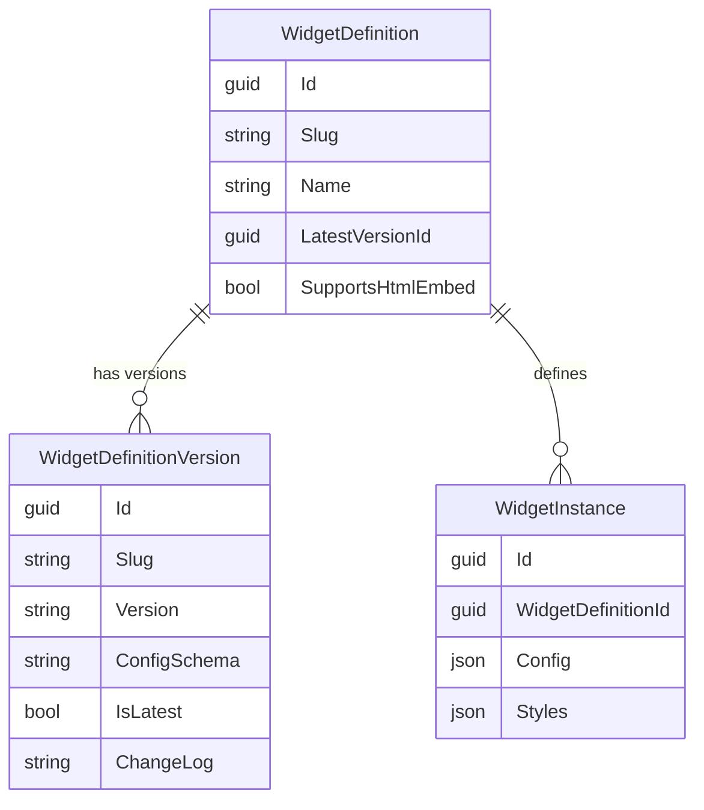
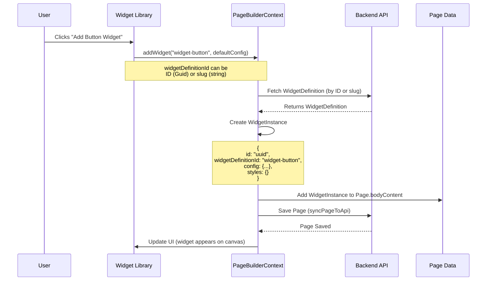
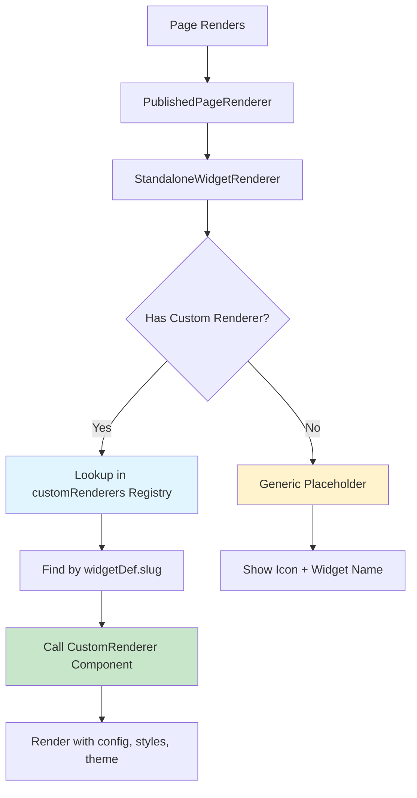
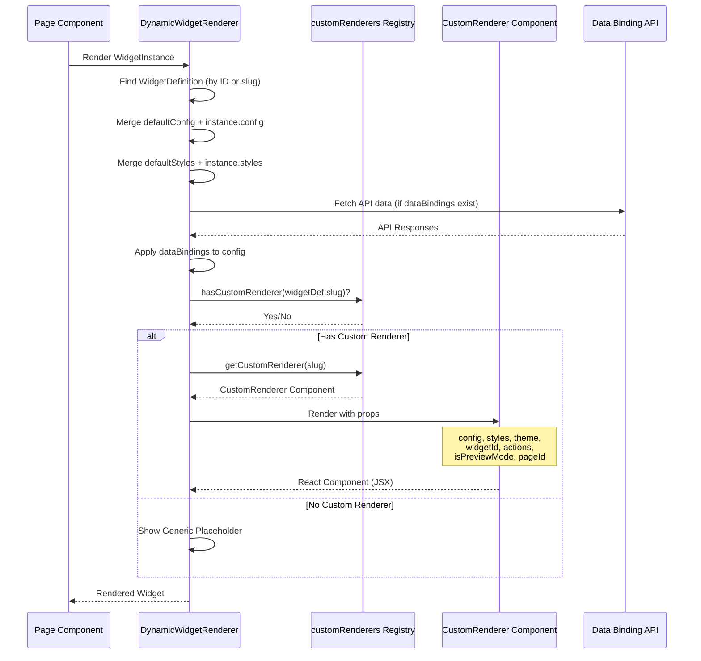
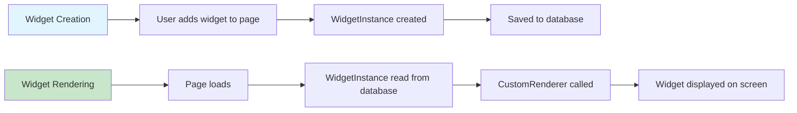

# Widget System Overview - Minimal Guide

## What is a Widget?

A widget is a reusable component that can be placed on a page. It has three main parts:
1. **WidgetDefinition** - The template/schema (stored in database)
2. **WidgetDefinitionVersion** - A specific version of the widget with its own schema and defaults
3. **WidgetInstance** - A specific widget placed on a page with user settings

## Widget Versioning

Widgets support **versioning** to allow multiple versions to coexist. This enables backward compatibility when making breaking changes.



**How it works:**
- Each widget (identified by `Slug`) can have multiple versions (v1, v2, etc.)
- The `WidgetDefinition` table stores denormalized data from the **latest** version for convenience (including **`SupportsHtmlEmbed`**, which opts the widget into the external HTML embed API when the latest version declares it)
- The `WidgetDefinitionVersion` table stores all versions with their specific schemas
- Existing `WidgetInstance` records continue to work as the system uses the definition's config

## How Widgets Are Created



**Key code locations:**
- `frontend/contexts/PageBuilder/usePageBuilderWidgets.ts` — `addWidget` (widget placement and page update)
- `frontend/contexts/PageBuilderContext.tsx` — re-exports the page builder context from `frontend/contexts/PageBuilder/`

## How Custom Renderers Work



**Rendering Flow:**



## Custom Renderer Registry

**Location:** `frontend/components/builder/customRenderers/index.ts`

At build time, `require.context` scans the repo-level `widgets/` tree for versioned entry files (`widget-*/v*/index.tsx`, optional brand segment). The module fills `customRenderers` (slug → **latest** major version) and `versionedRenderers` (slug → major version → component). **You do not maintain a manual slug list** when adding a new widget—only add the widget folder and files under `widgets/`.

## Custom Renderer Structure

**What is a CustomRenderer?**
A React component function that receives props and returns JSX (HTML-like code).

**Example - ButtonRenderer:**

```typescript
export const ButtonRenderer: CustomRenderer = ({
  config,        // User's widget settings (text, url, variant)
  styles,         // Visual styles (padding, colors, etc.)
  theme,          // Brand theme (colors, fonts)
  widgetId,       // Unique widget instance ID
  actions,        // Click handlers, etc. (optional)
  isPreviewMode,  // Is this preview or edit mode? (optional)
  pageId,         // Current page ID (optional)
}) => {
  // Extract values from config
  const text = config.text || 'Click Me';
  const url = config.url || '#';
  
  // Return JSX (what gets displayed)
  return (
    <Button onClick={handleClick}>
      {text}
    </Button>
  );
};
```

## Widget Creation vs Rendering



## Key Files

### Backend

| File | Purpose |
|------|---------|
| `backend/src/Cms.Domain/Entities/WidgetDefinition.cs` | Widget definition entity |
| `backend/src/Cms.Domain/Entities/WidgetDefinitionVersion.cs` | Widget version entity |
| `backend/src/Cms.Domain/Interfaces/IWidgetVersionProvider.cs` | Interface for versioned widget definitions |
| `backend/src/Cms.Domain/Interfaces/IWidgetDefinitionProvider.cs` | Interface for legacy widget definitions |
| `backend/src/Cms.Persistence/Seeding/WidgetDefinitionDiscovery.cs` | Auto-discovers widget definitions via reflection |
| `backend/src/Cms.Persistence/Seeding/DatabaseSeeder.cs` | Seeds and syncs widget definitions |
| `backend/src/Cms.Api/Controllers/WidgetsController.cs` | API endpoints for widgets and versions |

### Frontend

| File | Purpose |
|------|---------|
| `frontend/contexts/PageBuilder/usePageBuilderWidgets.ts` | `addWidget` and related page-builder widget mutations |
| `frontend/contexts/PageBuilder/PageBuilderContext.tsx` | Page builder context (includes `supportedLangs`, etc.) |
| `frontend/components/builder/customRenderers/index.ts` | Registry of all custom renderers |
| `frontend/components/viewer/PublishedPageRenderer.tsx` | Renders widgets on published pages |
| `frontend/components/builder/DynamicWidgetRenderer.tsx` | Renders widgets in builder |
| `frontend/lib/widgetEndpointSsr.ts` | Builds widget endpoint map from `widgets/*/v*/ssrEndpoints.ts`; preview page calls `resolveWidgetEndpointConfig` for body and layout widgets so initial HTML has API-backed data. Widgets opt in by adding `ssrEndpoints.ts` (see [widgets/README.md](../widgets/README.md)). |

### Widget Folder

Paths may be flat (`widgets/widget-{slug}/...`) or grouped by brand (`widgets/{brand}/widget-{slug}/...`). The `{slug}` segment (folder name and `Slug` in code) is always `widget-*`.

| File | Purpose |
|------|---------|
| `widgets/widget-{slug}/v{n}/Definition.cs` or `widgets/{brand}/widget-{slug}/v{n}/Definition.cs` | Versioned widget definition (`IWidgetVersionProvider`) |
| `widgets/widget-{slug}/v{n}/index.tsx` or `widgets/{brand}/widget-{slug}/v{n}/index.tsx` | React renderer for this version |
| `.../ssrEndpoints.ts` (same version folder as above) | Optional. SSR endpoint mapping so the published page can pre-fill API data on first paint (see [widgets/README.md](../widgets/README.md)). |
| `widgets/widget-{slug}/Controller.cs` or `widgets/{brand}/widget-{slug}/Controller.cs` | Optional widget-specific API endpoints |

### External HTML embed (host-facing)

For SEO, a **host application** can server-side `fetch` `GET /api/embed/widget` on the CMS Next.js app and inline the returned HTML (no iframe). Flow:

1. Request includes `brand`, `widgetId` (instance id), optional `uri` (page path) and `lang`.
2. The route loads the published page, finds the instance on **page body** only (`frontend/lib/embed/findWidgetInPageBody.ts`), and resolves the widget definition.
3. If `supportsHtmlEmbed` is false or the instance is not on the body → **404**. If true but `getEmbedRenderer(slug)` has no template in `frontend/lib/embed/embedRenderers.tsx` → **501**. Otherwise the route server-renders the embed component and returns HTML.

Details, authentication (`EMBED_API_SECRET`), status codes, and builder **Copy embed link** UX: [widget-html-embed.md](./widget-html-embed.md).

| File | Purpose |
|------|---------|
| `frontend/app/api/embed/widget/route.ts` | Embed HTTP handler (auth, lookup, `renderToString`) |
| `frontend/lib/embed/embedRenderers.tsx` | Slug → embed React components (`getEmbedRenderer`) |
| `frontend/lib/embed/findWidgetInPageBody.ts` | Locates a widget instance in page body JSON |
| `frontend/lib/embed/loadPublishedPageForEmbed.ts` | Loads published page + theme + definitions for embed |
| `frontend/components/builder/WidgetEmbedLinkSection.tsx` | Builder UI: copy embed URL, language selector |

## Simple Summary

1. **Widget Creation**: User clicks → `addWidget()` → Creates `WidgetInstance` → Saves to page
2. **Widget Rendering**: Page loads → Finds `WidgetInstance` → Looks up `CustomRenderer` by slug → Renders component
3. **Custom Renderer**: A React component that takes config/styles/theme and returns JSX

---

## How to Create a New Widget (Developer Guide)

> **Note:** For detailed instructions, see [WidgetDevelopmentGuideV2.md](./WidgetDevelopmentGuideV2.md).

### Step 1: Create Widget Folder with Version

Create the folder structure: `widgets/widget-my-widget/v1/`

### Step 2: Add Definition.cs (Backend)

Create `widgets/widget-my-widget/v1/Definition.cs` implementing `IWidgetVersionProvider`:

```csharp
using System.Text.Json;
using Cms.Domain.Enums;
using Cms.Domain.Interfaces;
using Cms.Domain.ValueObjects;

namespace Cms.Widgets.MyWidget.V1;

public sealed class MyWidgetV1Definition : IWidgetVersionProvider
{
    private static readonly JsonSerializerOptions JsonOptions = new()
    {
        PropertyNamingPolicy = JsonNamingPolicy.CamelCase,
        WriteIndented = false
    };

    public string Slug => "widget-my-widget";
    public string Version => "1.0.0";

    public WidgetVersionInfo GetVersionInfo()
    {
        var configSchema = JsonSerializer.Serialize(new
        {
            fields = new object[]
            {
                new { name = "title", label = "Title", type = "text", required = true },
                new { name = "content", label = "Content", type = "textarea", required = false }
            }
        }, JsonOptions);

        var defaultConfig = JsonSerializer.Serialize(new
        {
            title = "Default Title",
            content = "Default content"
        }, JsonOptions);

        return new WidgetVersionInfo(
            Id: Guid.Parse("xxxxxxxx-xxxx-xxxx-xxxx-xxxxxxxxxxxx"),
            Name: "My Widget",
            Description: "Widget description",
            Category: WidgetCategory.Content,
            Icon: "star",
            Thumbnail: null,
            ConfigSchema: configSchema,
            DefaultConfig: defaultConfig,
            DefaultStyles: new WidgetStyles { Padding = "md" },
            ChangeLog: null,
            IsAdvanced: false,
            BrandIds: null,
            SupportsHtmlEmbed: false
        );
    }
}
```

### Step 3: Create CustomRenderer (Frontend)

Create `widgets/widget-my-widget/v1/index.tsx`:

```tsx
'use client';

import React from 'react';
import type { CustomRenderer } from '@/types/renderTemplate';
import { getPadding, getStyleValue } from '@/lib/styleUtils';

const MyWidgetRenderer: CustomRenderer = ({
  config,
  styles,
  theme,
}) => {
  const title = (config.title as string) || 'Default Title';
  const content = (config.content as string) || '';

  return (
    <div
      style={{
        padding: getPadding(styles.padding as string),
        backgroundColor: getStyleValue(styles.backgroundColor as string, theme.colors.background),
      }}
    >
      <h2>{title}</h2>
      <p>{content}</p>
    </div>
  );
};

export default MyWidgetRenderer;
```

### Step 4: Validate and Run

```bash
npm run widget:validate
npm run dev
```

**Done!** Widget is auto-discovered and appears in the widget library.

**Important Notes:**
- No manual registration needed — the seeder discovers widgets automatically
- The `Slug` must match the folder name (e.g., `widget-my-widget`)
- Each version needs a unique GUID for the `Id`
- Run `npm run widget:validate` to check for contract errors

---

**Note**: If a widget has no custom renderer, it shows a generic placeholder with the widget name and icon.
