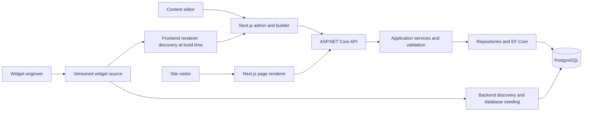
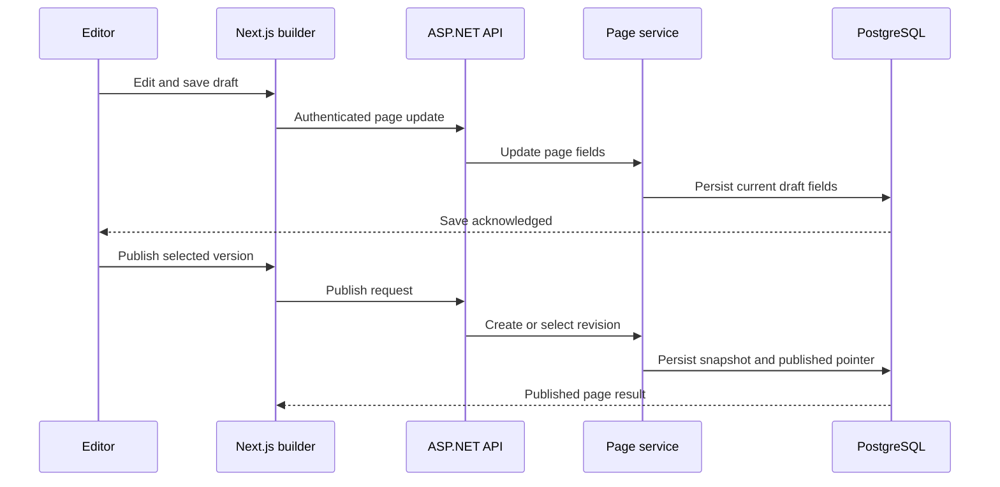

# System architecture

## Verified stack

| Area | Repository evidence |
|---|---|
| Frontend | Next.js 15.2 range, React 18.3, TypeScript 5.8, Tailwind 3.4, TanStack Query 5; frontend/package.json. Node engine >=22. |
| Backend | ASP.NET Core / .NET 10 target; SDK pinned to 10.0.100 with latestFeature roll-forward; API uses FluentValidation, JWT bearer, EF Core, Swashbuckle and Serilog. |
| Persistence | PostgreSQL through Aspire.Npgsql.EntityFrameworkCore.PostgreSQL; EF Core migrations under backend/src/Cms.Persistence/Migrations. |
| Orchestration | .NET Aspire AppHost. Development provisions PostgreSQL with persistent volume and API; frontend registration is commented out. Production expects external cmsdb connection string. |
| Tests | xUnit-style backend projects Cms.Api.Tests and Cms.Application.Tests; Vitest frontend. |

HLD’s Next.js 14 and Node 18 claims are outdated relative to package.json. PostgreSQL major version is not pinned in reviewed source; do not claim 15 without deployment configuration evidence.

## Components

- Next.js App Router serves admin routes, preview pages, widget custom renderers, API embed route, sitemap, and sign-in handlers.
- ASP.NET API controllers expose auth, pages, brands/domains, widgets/versions, templates, themes, site layouts/settings, media, redirects, page data, users/assignments, roles, audit logs, system and proxy endpoints.
- Application layer contains services and validators; persistence layer uses repositories and CmsDbContext/Identity; domain entities model brands, pages, revisions, widgets, roles/permissions and media.
- PostgreSQL schema includes cms-scoped Identity tables and CMS entities; schema configuration is via EF Core.
- No Redis/distributed cache or CDN integration was confirmed in active implementation. HLD identifies these as future/planned.

## Component and request diagrams

The sequence illustrates the intended current code path. It does not prove atomic rollback on storage failure or enforce a publish-specific permission; those are gaps listed below.

## Save and publish flow

1. Builder state composes Page and WidgetInstance JSON, page data config, SEO/theme/layout/CSS.
2. Frontend API service sends authenticated request to PagesController.
3. PageService loads/creates/updates domain entities and repository saves via EF Core.
4. Save updates mutable page/draft fields. The entity has DraftRevisionId, but inspected update path primarily updates current fields; do not assume a new immutable draft snapshot on every save.
5. Publish validates version string, makes PageRevision from current page fields (or selects an existing revision), then updates status, version, published pointer and timestamps.
6. Page lookup for public URI obtains published page/revision; Next.js renders it using PublishedPageRenderer and SiteLayoutWrapper.

## Widget flow

Widget C# definitions are discovered by backend seeding/reflection and stored as definition/version records. React renderer files are found at frontend build time. The editor serializes instance configuration and bindings; runtime resolves definition, custom renderer, theme, and optional endpoint SSR map. An API-backed widget may call public/mock data or configured endpoint paths. Error handling/isolation should be verified per widget.

## Authentication, authorization, tenant boundary

Password login and optional provider callback issue JWT-based identity; ASP.NET Identity stores users. ASP.NET authorization policies map to permission requirements resolved from role assignments. Frontend AuthContext and AdminShell control navigation/redirects. Controllers sometimes have class-level authentication and per-action policies, but many CMS operations are authenticated without a specific policy. Data access has brand IDs but no global query filter. See USER_ROLES_AND_PERMISSIONS.md for critical scope risk. Keep authorization intact; strengthen checks server-side.

## Routing and external output

Brand/domain resolution identifies a tenant. PageService supports static and dynamic published route matching. Next.js dynamic preview route renders the selected page. BrandsController exposes sitemap output; site settings include robots/canonical/script fields. Redirects are separate brand-scoped records. The embed endpoint only supports allow-listed HTML fragment rendering. Full production DNS/TLS/CDN routing is deployment-specific and not shown.

## Local development

README describes Aspire and standalone modes, plus Docker. AppHost code provisions a persistent Postgres resource and API in Development; frontend is not started by Aspire in current code. To run standalone, provide the DB and JWT configuration, run migrations/API, then frontend. Do not copy secrets from local env files into docs. Environment examples should be treated as configuration references, not secret sources.

## Architecture gaps and cautions

- HLD has architecture claims beyond verified code; use source over HLD where they conflict.
- Page/template/resource authorization must be applied at object-brand scope.
- Open CORS policy is configured in Program.cs and needs deployment-appropriate restriction.
- Some login/register/bootstrap endpoints are anonymous; production policy must be reviewed.
- Database media storage is a scalability constraint; blob fields are future/reserved.
- No verified concurrency token, distributed cache, or comprehensive publication transaction guarantee.
- API may permit public file/page-data/layout/theme reads; ensure only intended public fields are returned.
