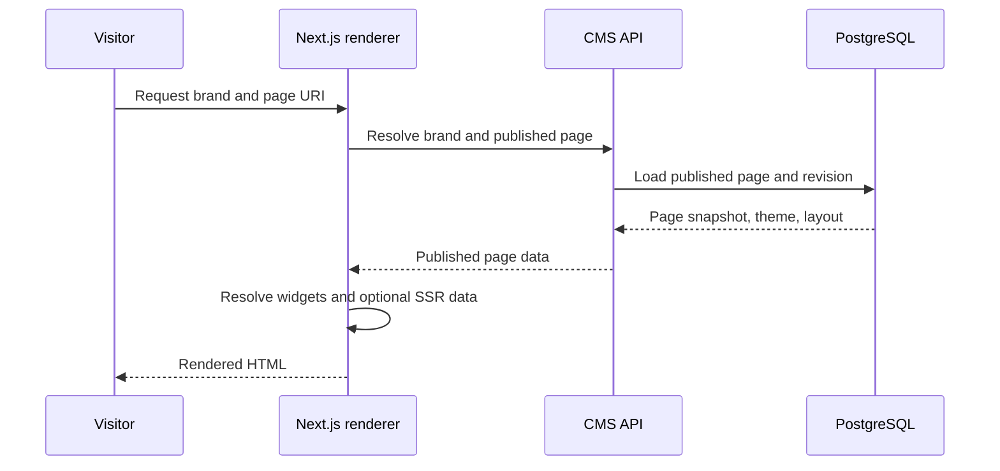

# User journeys

Each journey separates current behavior from gaps and proposals. Examples use fictional Brand A/Brand B to avoid asserting customer data.

## 1. Create and publish a page

1. Sign in at /login; AuthContext loads the JWT-backed user context.
2. Select Brand A at /brands and open /builder/[brandId]. The server must verify the user’s brand scope (current checks are inconsistent).
3. Create a page and enter its name/URI; choose layout/theme if available.
4. Insert widgets from the library, reorder them on the canvas, and edit schema-driven fields in the inspector.
5. Configure page variables/API calls and data bindings if the page needs dynamic content.
6. Configure metadata in PageSeoPanel, preview viewport sizes, save draft.
7. Run server validation (a complete publish-validation contract is not established), review the publish dialog, and publish with semantic version.
8. PageService creates/selects a PageRevision and sets PublishedRevisionId. Verify /preview/{brandKey}/{uri}; public rendering resolves only published content.

Gap: there is no distinct publish permission policy at PagesController, no approval workflow, and no optimistic concurrency protection found.

## 2. Create a page from a template

Documented/implemented data: templates store reusable JSON content with optional BrandId, category and thumbnail; API supports list/create/update. HLD says template application exists in the builder.

Expected safe workflow (proposal pending verification): choose a compatible template → instantiate a new page with a deep copy of BodyContent → set target brand and URL → edit/preview → save and publish. Editing the new page must not mutate the template. Template versions and migration policy are not present in the inspected entity; do not promise retroactive propagation or version rollback.

## 3. Develop and release a widget

1. Engineer scaffolds a widget using tools/widget-create.js or follows widgets/README.md.
2. Add version folder with Definition.cs schema/defaults and React renderer; optional ssrEndpoints.ts for published SSR data.
3. Validate via widget:validate and tests/build workflow.
4. Backend discovery reflects widget definition providers; database seeder upserts definition/version. Frontend renderer registry discovers files at build time.
5. Release requires application deployment/build; this is not an in-CMS code authoring workflow.
6. Editor selects widget from library, configures a placed instance; old page instances need compatibility testing when a new schema version is introduced.

## 4. Manage multiple brands

1. Admin creates brands and domains and assigns users scoped roles.
2. User selects an authorized brand and edits within its context.
3. Every API read/write resolves the resource’s brand and checks organization-wide or brand-scoped permission; current implementation has gaps, so this step is a requirement, not a verified universal guarantee.
4. Public requests resolve host/brand and route to that brand’s published page and theme.

## 5. Update a published page

1. Open existing page; current editor retrieves page record and draft content.
2. Modify and save the draft. PublishedPageRenderer should continue using the snapshot referenced by PublishedRevisionId.
3. Preview draft without exposing it publicly.
4. Publish to create a new snapshot and update the pointer; use a previous revision ID to republish older content.
5. Verify the public route and sitemap/metadata.

Concurrent writes are not detected by an optimistic concurrency token in the inspected Page entity/service. Add conflict prevention before relying on multi-editor behavior.

## 6. Handle failures

- Validation failure: keep editor content, show field/error context, block publication (server-side validation rules need formalization).
- API/network failure: preserve unsaved local state where possible, show retryable feedback, and never claim save succeeded before server acknowledgment.
- Widget runtime error: isolate/report the failing widget and preserve other page content; current error-boundary coverage needs verification.
- Publish failure: do not replace the active published pointer until revision persistence succeeds; verify transaction behavior and test this invariant.
- Concurrent edit: detect stale version and present reload/compare/reapply options; currently not verified/implemented.
- Unauthorized cross-brand request: return 403 or non-disclosing 404 and log security-relevant event; current coverage is inconsistent.

## 7. Manage media and SEO

1. Choose brand context; upload through media library. Backend validates format, can convert to WebP, saves metadata and DB bytes.
2. Add useful alt text and select image in widget fields. Verify brand scope server-side.
3. Set title/description/canonical/Open Graph and noindex/nofollow in page SEO panel.
4. Preview rendered tags and accessible image behavior; publish and verify live route and sitemap eligibility.

## Current high-level data paths

Editor: Next.js admin → API controller → application service → repository/EF Core → PostgreSQL. Page updates persist current draft fields; publish creates a revision snapshot and changes the published pointer.

Published request: browser → Next.js preview route → API resolves brand and published URI → selected PageRevision/theme/layout → renderer composes widget renderers and optional SSR endpoint data → HTML response. These are code/documentation paths, not an assertion of CDN/cache behavior.

